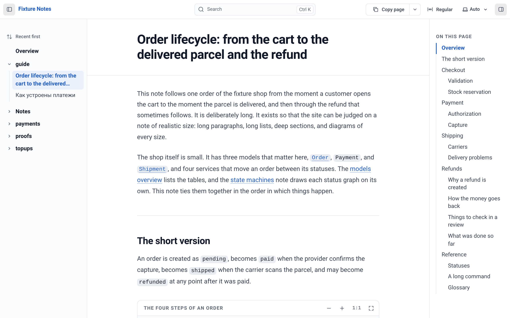
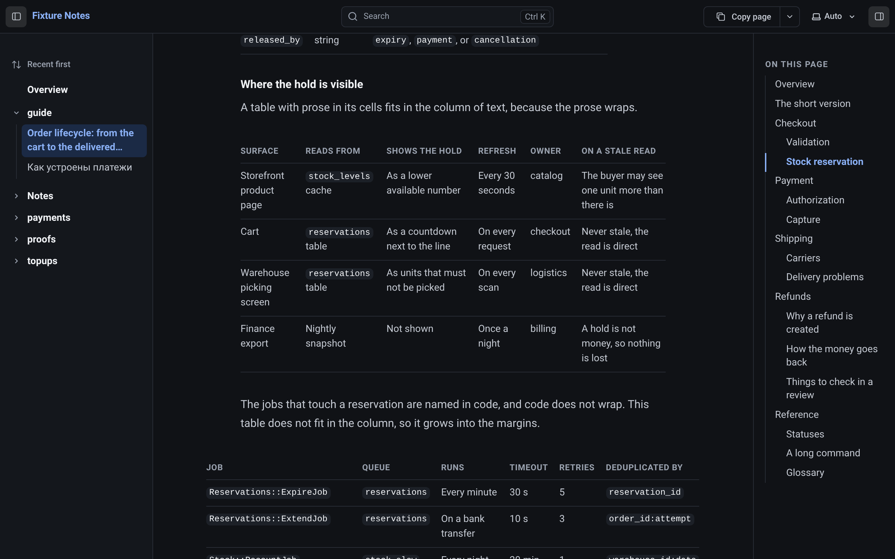
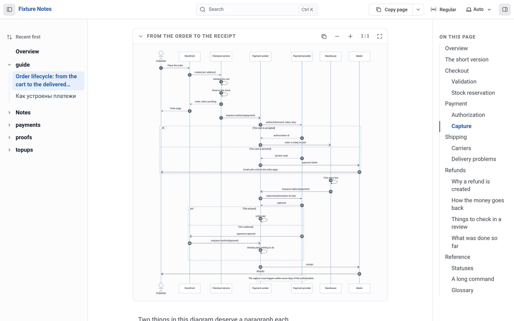
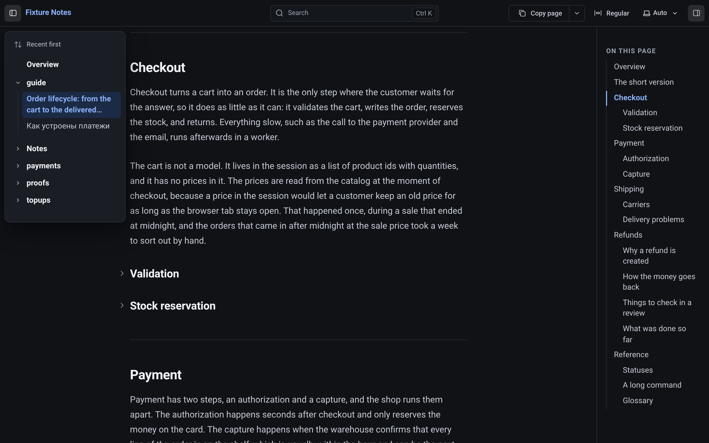

# notes

`notes` renders a folder of Markdown files as a local site with a sidebar, full-text search, Mermaid diagrams, code highlighting, and pages for the source files your notes link to. You run it from the root of a repository. It needs no setup there and writes everything it builds to one hidden folder.



| | | |
|---|---|---|
|  |  |  |
| Tables fit in the text column when they can and grow into the margins when they cannot. | Diagrams are drawn in the palette of the site, with a title, zoom, and full screen. They fold, and give their source to the clipboard. | Sections fold by their headings, and an unpinned tree floats in on hover. |

## Install

`notes` needs Node 22.12 or newer. Install it from the git repository, either for one project or for your user:

```sh
npm install --save-dev github:cutalion/notes   # one project, run it with `npx notes`
npm install --global github:cutalion/notes     # every project, run it with `notes`
```

The install downloads about 700MB of dependencies, most of it Astro, Mermaid, and Pagefind.

## Use

Run the commands from the root of the repository that holds the notes:

```sh
notes dev            # serve the notes and update the site when a note changes
notes build          # render every note and report the broken local links
notes serve          # build, then serve the result without watching
```

Each command takes the notes folder as an optional argument, for example `notes dev handbook`. Without it, the notes are read from `docs`.

`notes dev` prints the address of the site, `http://127.0.0.1:4321/` by default. When that port is busy and you did not ask for a port, it takes the next free one, so two repositories can serve their notes side by side.

`notes dev` reports a note with broken frontmatter and keeps serving the rest. It does not check links. `notes build` does: it lists each link to a missing note, heading, attachment, or source line as a warning. With `--strict`, such a link fails the build.

## Options

| Option | Default | Command line | Config file |
|---|---|---|---|
| Notes folder | `docs` | first argument | `dir` |
| Output folder | `.notes` | `--out` | `out` |
| Site title | `<repo folder> Notes` | `--title` | `title` |
| Site description | `Notes of <repo folder>` | | `description` |
| Port | 4321, or the next free one | `--port` | `port` |
| Fail on broken links | no | `--strict` | `strict` |
| Extra Markdown plugins | none | | `remarkPlugins` |

The config file is optional. It is `notes.config.mjs` in the repository root, and the command line overrides it:

```js
export default {
  dir: 'docs/notes',
  title: 'Shop Notes',
  port: 4400,
};
```

`remarkPlugins` takes [remark](https://github.com/remarkjs/remark) plugins, which run on every note. A plugin file lives in your repository, outside this package, so it cannot import the dependencies of `notes`.

## Write a note

A note is a `.md` file anywhere below the notes folder. It can start with YAML frontmatter:

```markdown
---
title: Refund flow
description: How a refund reaches the customer.
---

Body starts here.
```

The frontmatter and each of its fields are optional. Without a `title`, the note takes its title from the `# ` heading that opens it, or else from the file name. The sidebar groups notes by folder. Set `group` to put a note into another group.

`index.md` in the notes folder is the home page. Without it, the home page lists the notes by group.

A file or folder whose name starts with `_` or `.` is not part of the site. Use the `_` prefix for scripts and raw data that sit next to the notes.

Notes support tables, task lists, fenced code with highlighting, callouts such as `:::note` and `:::caution`, and `mermaid` code fences for diagrams.

## Link notes and files

Link another note by its relative path and keep the `.md` extension: `[Refund flow](payments/refunds.md#timeline)`. The link then also works for a person or a tool that reads the Markdown file.

Link a text file of the repository by its relative path, with `#L12` for a line or `#L12-L20` for a range: ``[`Order`](../app/models/order.rb#L12)``. The site shows that file as a highlighted page. A file that is missing from the current checkout gets a page that says so.

Link an image or another binary file the same way. The site serves a repository file only when a note links it.

## Notes and agents

`skills/notes/SKILL.md` teaches a coding agent to write notes for this tool: where a note goes, how to link code, how to title a diagram, and how to check the result with `notes build --strict`. Copy the `skills/notes` folder into the skills folder of your agent, for example `.claude/skills/notes` in your repository. In a project that has `notes` installed, the file is in `node_modules/notes/skills/notes`.

## What it writes

Everything goes to the output folder, `.notes` by default: the page shell, the rendered pages, the caches, and the search index. The folder ignores itself in git, so your `.gitignore` stays as it is. Each notes folder has its own pages, caches, and search index in `sites/<folder>` there, so two folders of one repository can be served at the same time. You can delete the output folder at any time. The next run builds it again.

The first run, and the first run after an update of `notes`, builds the page shell with Astro. That takes about five seconds and about 800MB of memory. After that, Astro does not run: `notes dev` starts in a few seconds, stays under 200MB, and shows a changed note in about a second.

## Develop

```sh
npm install
npm run check          # unit tests, then the Astro and TypeScript check
npm run test:browser   # builds the fixture notes and drives the site in Chromium
npm run test:fixture   # starts the dev server, adds a note, and checks the memory peak
```

The tests use the small repository in `tests/fixture`. The browser tests need a Chromium that Playwright can find, or its path in `PLAYWRIGHT_CHROMIUM_EXECUTABLE_PATH`.
