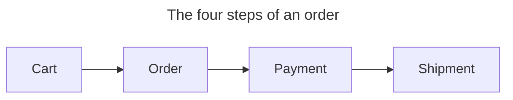
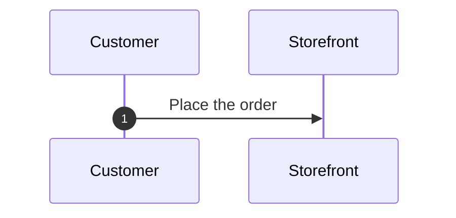

# Writing notes for the `notes` tool

`notes` renders a folder of Markdown files as a local site. A repository uses it when it has `notes` in its `package.json`, a `notes.config.mjs` in its root, or a `.notes` folder. The notes live in `docs` unless the config file sets `dir`.

A note stays a plain Markdown file. Write it so that it reads well both on the site and as a file in an editor or on GitHub.

## Check your work

Run the build from the root of the repository after you add or change a note:

```sh
npx notes build --strict
```

It renders every note and lists each link to a missing note, heading, attachment, or source line. With `--strict` such a link fails the build. Fix every one before you finish. If the notes are not in `docs`, give the folder: `npx notes build handbook --strict`.

Do not start `notes dev` or `notes serve` to check a note. They are servers and do not exit. Start one only when the user asks to see the site, and then run it in the background and give the user the address that it prints.

The first build in a repository takes about five seconds and about 800MB of memory. Later builds take about a second.

The tool writes everything to `.notes`. That folder ignores itself in git. Do not edit it, commit it, or add it to `.gitignore`.

## Where a note goes

- A note is a `.md` file anywhere below the notes folder. The folder of the note is its group in the tree.
- `index.md` in the notes folder is the home page.
- A file or folder whose name starts with `_` or `.` is not part of the site. Put scripts and raw data that belong to the notes there.
- Look at the folders that exist before you make a new one. A new note usually belongs in one of them.

## Frontmatter

Every field is optional, and so is the whole block:

```markdown
---
title: Refund flow
description: How a refund reaches the customer.
group: payments
---
```

- `title` is the name in the tree and the heading of the page. Without it the note takes the `# ` heading that opens it, or else the file name. Give one or the other, not both. Follow what the other notes of the repository do.
- `description` is one sentence that says what the note is about. It goes into the metadata of the page.
- `group` puts the note into another group than its folder.

Broken YAML here fails the note. Quote a title that has a colon in it: `title: "Order lifecycle: from the cart to the refund"`.

## Structure

The page has a contents panel built from the headings, and the reader can fold any section by its heading. So the headings carry the structure.

- Start sections at `##`. The title of the page is the only first-level heading.
- Do not skip a level: `####` goes inside a `###`.
- Give each heading words that say what the section is about. The contents panel shows them without the text around them.
- The text column is narrow, about 75 characters. Short paragraphs and lists read better than a wall of text.

## Links

**To another note:** use the relative path and keep the `.md` extension. Add the heading after `#`.

```markdown
[Refund flow](payments/refunds.md#timeline)
```

**To a source file of the repository:** use the relative path from the note. Add `#L12` for a line or `#L12-L20` for a range.

```markdown
[`Order#pay!`](../app/models/order.rb#L12-L20)
```

The site shows that file as a highlighted page with the lines marked. Prefer such a link to a pasted copy of the code: the copy goes stale, and the link is checked by the build.

**To an image or another binary file:** link it or embed it by its relative path. The site serves a repository file only when a note links it.

The part after `#` is the heading in lower case with hyphens for spaces: `## Stock reservation` is `#stock-reservation`. When the build says that a heading is missing, compare that part with the heading as it is written now.

## Code

Use a fenced block with the language, such as `ruby` or `sh`. The block gets highlighting and a copy button. A long line scrolls inside the block, so do not break a command to make it fit.

Use backticks for names of classes, methods, files, columns, and statuses in the text.

## Diagrams

A `mermaid` code fence becomes a diagram in a frame with zoom and full screen. Give every diagram a title. The frame shows it in its header, and a click on it folds the diagram. A button in the frame copies the Mermaid source in its code fence.

````markdown

````

An `accTitle:` line inside the diagram works too, in any kind of diagram:

````markdown

````

- Do not set colours with `classDef` or `style` unless a colour carries a meaning. The site draws diagrams in its own palette for the light and the dark theme, and a colour that you set wins over it in both.
- A diagram that is wider than the text column grows into the margins, and then shrinks. A diagram taller than most of the window shrinks too. Split a diagram with more than about 25 steps into two.
- Prefer `flowchart LR` for a short chain and `flowchart TD` for a tree with branches.

## Tables

A table first tries to fit in the text column, then grows into the margins, and only then scrolls sideways. You control which of these happens:

- Ordinary text in a cell wraps. Code in backticks does not. So a table with many columns of identifiers gets wide, and a table with prose stays in the column.
- Put the column that names the row first. It stays in place when the table scrolls.
- Keep column headings short. A heading does not wrap.
- More than about six columns rarely fits. Split the table, or turn the columns that few readers need into a list below it.

## Callouts

Use a callout for one thing that the reader must not miss, not for ordinary text:

```markdown
:::note
The capture must happen within seven days of the authorization.
:::

:::caution
This job is not safe to run twice.
:::
```

## Common problems

| What you see | What to do |
| --- | --- |
| The build reports a link to a missing note | Check the relative path from the note that holds the link, and keep the `.md` extension |
| The build reports a missing heading | The heading was renamed. Update the part after `#` |
| The build reports a missing source line | The file got shorter or moved. Open it and correct the path or the lines |
| A note is not in the tree | Its name or a folder above it starts with `_` or `.`, or it is outside the notes folder |
| A note fails with a frontmatter error | Fix the YAML. Quote a value that has a colon |
| A diagram shows an error instead of a picture | The Mermaid source is wrong. Check it against the Mermaid syntax for that kind of diagram |
