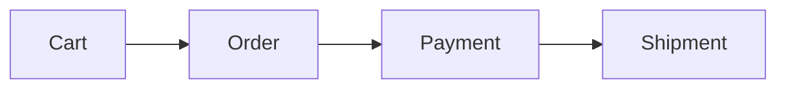
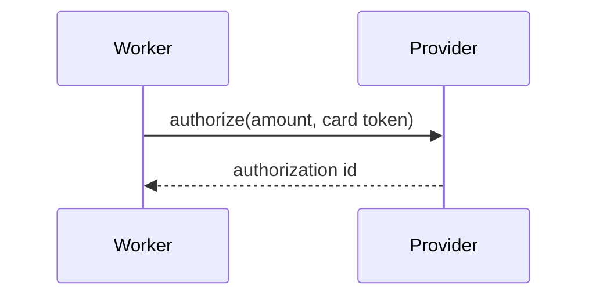
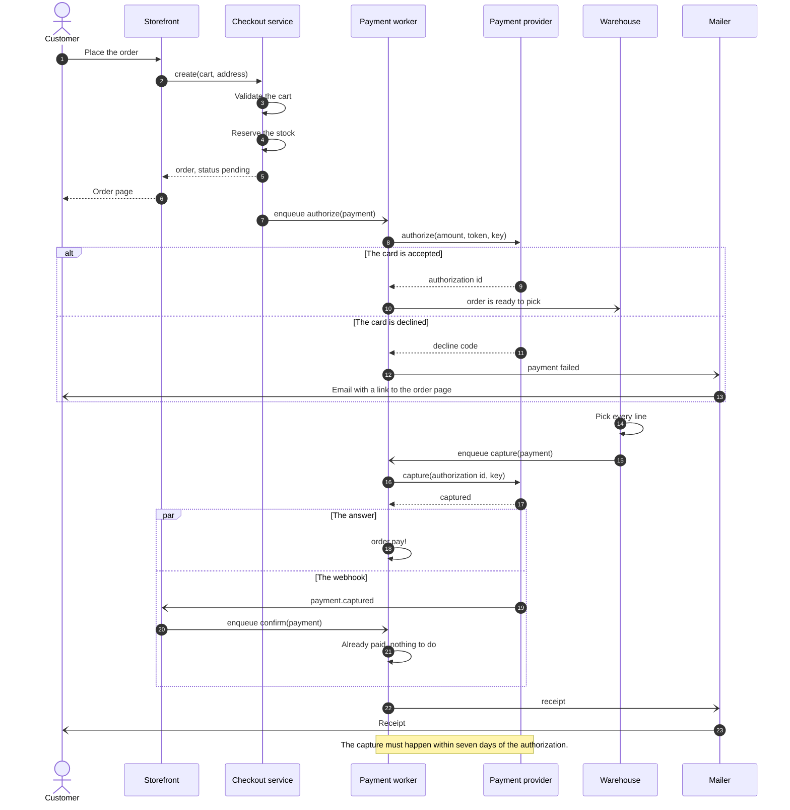
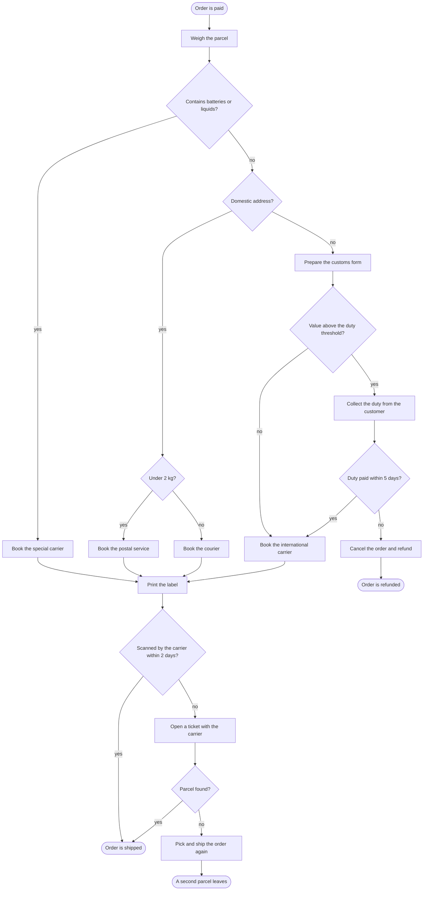
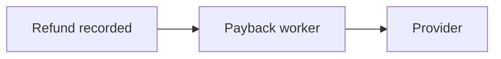
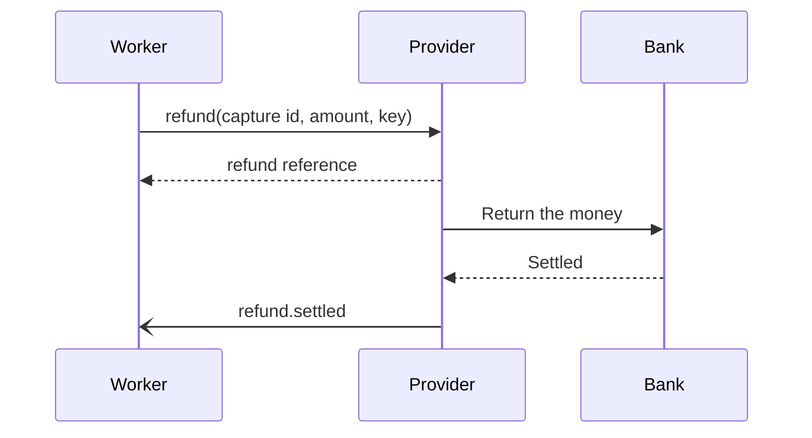

This note follows one order of the fixture shop from the moment a customer opens the cart to the moment the parcel is delivered, and then through the refund that sometimes follows. It is deliberately long. It exists so that the site can be judged on a note of realistic size: long paragraphs, long lists, deep sections, and diagrams of every size.

The shop itself is small. It has three models that matter here, [`Order`](../../app/models/order.rb#L1), `Payment`, and [`Shipment`](../../app/models/shipment.rb), and four services that move an order between its statuses. The [models overview](../models-overview.md) lists the tables, and the [state machines](../payments/state-machines.md) note draws each status graph on its own. This note ties them together in the order in which things happen.

## The short version

An order is created as `pending`, becomes `paid` when the provider confirms the capture, becomes `shipped` when the carrier scans the parcel, and may become `refunded` at any point after it was paid.



Everything below is the long version of that one line. If you only need to know which service to read, here is the list:

- `Checkout::Create` builds the order from the cart.
- `Payments::Authorize` reserves the money.
- `Payments::Capture` takes the money.
- `Shipments::Book` asks the carrier for a label.
- `Refunds::Create` records a refund.
- `Refunds::Payback` returns the money.

:::note
The status of an order changes in exactly one place, the `pay!` method of the model and its siblings. No service writes the `status` column directly, and a review should reject a change that does.
:::

## Checkout

Checkout turns a cart into an order. It is the only step where the customer waits for the answer, so it does as little as it can: it validates the cart, writes the order, reserves the stock, and returns. Everything slow, such as the call to the payment provider and the email, runs afterwards in a worker.

The cart is not a model. It lives in the session as a list of product ids with quantities, and it has no prices in it. The prices are read from the catalog at the moment of checkout, because a price in the session would let a customer keep an old price for as long as the browser tab stays open. That happened once, during a sale that ended at midnight, and the orders that came in after midnight at the sale price took a week to sort out by hand.

### Validation

The service checks the cart before it opens a transaction, so that a cart that cannot become an order does not hold a lock on anything.

1. Every product in the cart still exists and is still for sale. A product that was withdrawn after it was added is removed from the cart, and the customer sees a message that names it.
2. The quantity of each line is between one and the limit for a single order, which is 20 for most products and 2 for the ones marked as limited.
3. The cart is not empty after the first two checks removed what they had to remove.
4. The delivery address belongs to a country that the shop ships to.
5. The total is above the minimum for card payments.

A failure of any check returns the cart to the customer with the reason. None of them is logged as an error, because none of them is one.

### Stock reservation

Stock is reserved inside the same transaction that writes the order, with a row lock on each stock record, taken in the order of the product ids. The fixed order matters. Two customers who buy the same two products in opposite order would otherwise each lock one record and wait for the other, and the database would kill one of the two transactions after the deadlock timeout.

```ruby
Order.transaction do
  products = Product.where(id: cart.product_ids).order(:id).lock
  products.each { |product| product.reserve!(cart.quantity_of(product)) }
  Order.create!(customer:, lines: cart.lines_with_prices(products), status: 'pending')
end
```

A reservation is not a sale. It lowers the number that the storefront shows as available, and it expires after 30 minutes if the order is still `pending`. The expiry is a scheduled job that runs every minute and releases what it finds, and it is safe to run twice, because it releases a reservation by setting a timestamp only where the timestamp is empty.

#### What a reservation holds

| Field | Type | Meaning |
|---|---|---|
| `order_id` | bigint | The order that holds the stock |
| `product_id` | bigint | The product that is held |
| `quantity` | integer | How many units are held |
| `expires_at` | timestamp | When the hold is dropped if the order is still `pending` |
| `released_at` | timestamp | When the hold was dropped, or empty while it is active |
| `released_by` | string | `expiry`, `payment`, or `cancellation` |

#### When a reservation ends

- **The payment is captured.** The reservation becomes a sale: the stock record loses the units for good, and the reservation is released with `payment`.
- **The customer cancels.** The units go back to the available number at once, and the reservation is released with `cancellation`.
- **Nothing happens for 30 minutes.** The scheduled job releases the reservation with `expiry` and cancels the order.

##### Expiry and slow payments

A bank transfer can take longer than 30 minutes to arrive. For that payment method the reservation is created with an expiry of three days, and the order page tells the customer the date by which the money has to arrive.

###### The one exception

A pre-order has no stock to reserve, so it has no reservation at all. The order is written with a flag, and the stock is taken when the product arrives at the warehouse.

## Payment

Payment has two steps, an authorization and a capture, and the shop runs them apart. The authorization happens seconds after checkout and only reserves the money on the card. The capture happens when the warehouse confirms that every line of the order is on the shelf, which is usually within the hour and can be the next morning.

Splitting the two steps costs some complexity, and it pays for itself the first time a product turns out to be missing. An authorization that is never captured simply expires, and the customer sees nothing on the statement. A capture that has to be undone is a refund, which takes days to reach the customer, costs a fee, and counts against the shop with the provider.

### Authorization



The worker sends the amount and the card token and stores the authorization id on the payment. The provider answers within two seconds in almost every case. When it does not, the worker does not know whether the authorization exists, and it must not simply try again, because a second authorization would reserve the money twice.

- **Use an idempotency key.** The worker sends the id of the payment record as the key. The provider returns the first answer again for a repeated key, so a retry after a timeout is safe. This is the single most important detail of the whole integration, and it is easy to break: a refactoring that builds the key from the attempt number, or from a timestamp, makes every retry a new authorization. The test that covers it sends the same request twice and asserts that the provider stub saw one key.
- **Retry with a growing delay.** The worker retries after 5 seconds, then 30, then 3 minutes, and gives up after the third attempt. Giving up marks the payment as `failed` and releases the reservation.
- **Do not retry a decline.** A declined card is an answer, not an error. The worker records the decline code and stops. The customer gets an email with a link to the order page, where another card can be entered. Retrying a decline is worse than useless: several declines in a row for one card look like card testing to the provider, and the provider may block the shop's account for the rest of the day.

### Capture

The capture is triggered by the warehouse, and it is the moment the order becomes `paid`. The method that changes the status is short, and it refuses to run twice: see [`pay!`](../../app/models/order.rb#L13) in the model.

The full exchange involves more parties than the authorization does, because the provider reports the result twice: once in the answer to the request, and once more in a webhook that may arrive before or after that answer.



Two things in this diagram deserve a paragraph each.

The first is the race between the answer and the webhook. Both lead to the same method, and whichever comes second finds the order already `paid`. That is why the worker checks the status first and treats "already paid" as success, not as an error. The first version of this code raised an exception in that case, the job system retried the job, and the error tracker collected several hundred identical reports a day until someone read the diagram above and saw that the second arrival is the normal case, not the exceptional one.

The second is the seven-day limit in the note at the bottom. An authorization that is not captured within seven days expires on the provider's side without any notification. The shop finds out only when the capture fails. A scheduled job therefore looks every morning for authorizations older than five days and either captures them, if the warehouse has confirmed the order, or asks the customer service team to decide.

:::caution
A capture for less than the authorized amount is allowed, and a capture for more is not. When the warehouse cannot find one line of an order, capture the rest and let the remainder of the authorization expire. Do not cancel the authorization and create a new one: the customer's bank may decline the second request.
:::

## Shipping

Once the order is `paid`, the shipping service books a label with a carrier. Which carrier depends on the destination, the weight, and whether the order contains anything that the cheaper carriers refuse to take.



The order becomes `shipped` on the first scan by the carrier, not when the label is printed. A printed label only says that the warehouse intends to hand the parcel over. Customers who received a "your order has shipped" email for a parcel that then sat on a pallet for three days wrote, understandably, to ask where it was.

### Carriers

The shop works with four carriers. They differ in more than price.

- **The postal service** is the cheapest and the slowest, and it is the default for anything light that stays in the country. It has no pickup: a van from the warehouse takes the parcels to the sorting office once a day, at four in the afternoon. An order that is picked at ten past four leaves the next day. Tracking is coarse, with one scan at the sorting office and one at delivery, and nothing in between. For most orders that is enough. For the ones where it is not, customer service can see nothing more than the customer can, and the honest answer to "where is my parcel" is "somewhere between the two scans".
- **The courier** takes everything over two kilograms and everything that a customer paid to have sooner. It picks up twice a day and scans at every handover, so the tracking page has six or seven entries for a typical delivery. It also charges for a failed delivery attempt, which the shop does not pass on to the customer, so an address that the courier cannot find costs twice.
- **The international carrier** handles every parcel that crosses a border. It needs a customs form, which the shop fills in from the order lines, and a tariff code for every product, which the catalog team maintains. A product without a tariff code cannot be shipped abroad at all, and checkout refuses such an order at the validation step and says so.
- **The special carrier** is the only one that accepts batteries and liquids. It is expensive, it picks up only on request, and it needs a day's notice. Orders that need it are batched: the warehouse requests one pickup for everything that accumulated since the last one.

### Delivery problems

Most parcels arrive. The ones that do not fall into a handful of cases, and each has a fixed response, so that customer service does not have to improvise.

1. **The parcel was never scanned.** After two days without a scan the shipping service opens a ticket with the carrier. After five days it treats the parcel as lost and ships the order again.
2. **The parcel is stuck.** A parcel with a scan but no movement for seven days gets the same ticket. The carrier usually finds it.
3. **The address is wrong.** The carrier returns the parcel. The shop writes to the customer for a corrected address and ships again at its own cost the first time.
4. **Nobody was home.** The carrier leaves a card and tries again, or holds the parcel at a depot. The shop does nothing unless the parcel comes back.
5. **The parcel arrived damaged.** The customer sends a photo. The shop ships a replacement at once and claims the cost from the carrier afterwards, which succeeds about half the time.
6. **The parcel arrived incomplete.** The warehouse checks the pick record. If a line was missed, it ships the missing line. If the record says the line was packed, the case goes to a person.
7. **The wrong product arrived.** The shop ships the right one and sends a return label for the wrong one.
8. **The parcel was delivered to a neighbor.** The carrier's tracking says so. Customer service tells the customer which neighbor.
9. **The parcel was marked as delivered and the customer does not have it.** The shop asks the carrier for the delivery photo or the signature. Without either, the carrier pays.
10. **The customer refused the parcel.** It comes back, and the order is refunded less the shipping cost.
11. **Customs held the parcel.** The customer has to pay the duty or provide a document. The shop can only forward the carrier's message.
12. **The parcel was returned without a reason.** It happens. The shop writes to the customer and waits a week before refunding.

## Refunds

A refund returns money for an order that was paid. It can cover the whole order or a part of it, and one order can have several.

> A refund is a record first and a movement of money second. Write the record when the decision is made, move the money in a worker, and never let the second step change what the first one wrote.

That rule comes from the [note on refunds](../payments/refunds.md), and the rest of this section is what follows from it.

### Why a refund is created

- The customer returned the goods.
- The parcel was lost and the customer preferred money to a replacement.
- A line could not be picked after the capture.
- The customer was charged twice.
- The price was wrong and the shop chose to honor the lower one.
- Customer service granted a goodwill refund.

### How the money goes back



The payback worker reads refunds that have no provider reference yet and sends each to the provider with the refund id as the idempotency key. The provider answers with a reference, and the worker stores it.



The order becomes `refunded` only when the refunds on it add up to the captured amount. A partial refund leaves the status alone and shows on the order page as a line under the total.

### Things to check in a review

- [ ] The refund amount is never larger than what is left of the capture.
- [ ] The worker sends the refund id as the idempotency key.
- [ ] A provider error leaves the refund without a reference, so that the next run retries it.
- [ ] The order status changes only through the model.
- [ ] The customer is told by email, with the amount and the expected date.

## Reference

### Statuses

| Status | Set by | Next |
|---|---|---|
| `pending` | `Checkout::Create` | `paid`, or cancelled by expiry |
| `paid` | `Order#pay!` after the capture | `shipped`, `refunded` |
| `shipped` | The first carrier scan | `refunded` |
| `refunded` | The last refund that completes the captured amount | none |

### A long command

The line below does not fit the column, so the block scrolls sideways and the page does not.

```sh
bin/shop orders export --status paid --since 2026-01-01 --until 2026-06-30 --carrier international --format csv --columns id,customer_email,total_cents,captured_at,tracking_number --output tmp/exports/paid-international-first-half.csv
```

### Glossary

- **Authorization** is a reservation of money on the customer's card. It expires after seven days.
- **Capture** is the step that takes authorized money. It makes the order `paid`.
- **Reservation** is a hold on stock for an order that is not paid yet.
- **Payback** is the movement of money for a refund that is already recorded.
