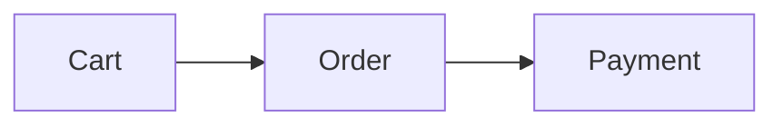
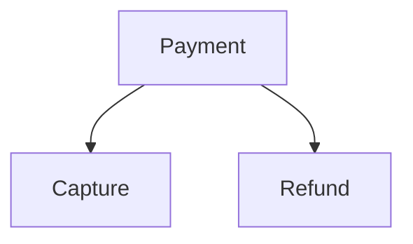
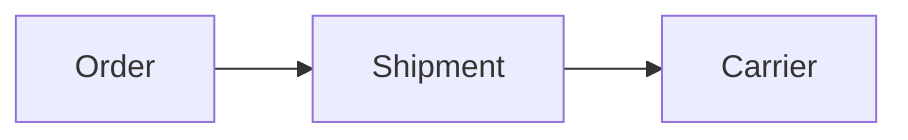

The shop has orders, payments, and shipments. The [`Order`](../app/models/order.rb#L13) model owns the status.

## Orders

| Model | Table | Owner |
|---|---|---|
| Order | orders | checkout |
| Payment | payments | billing |
| Shipment | shipments | logistics |

## Payments

### Capture

A capture moves the money. A refund returns it.

## Shipments

The legacy account model is [gone from this checkout](../app/models/legacy_account.rb).
